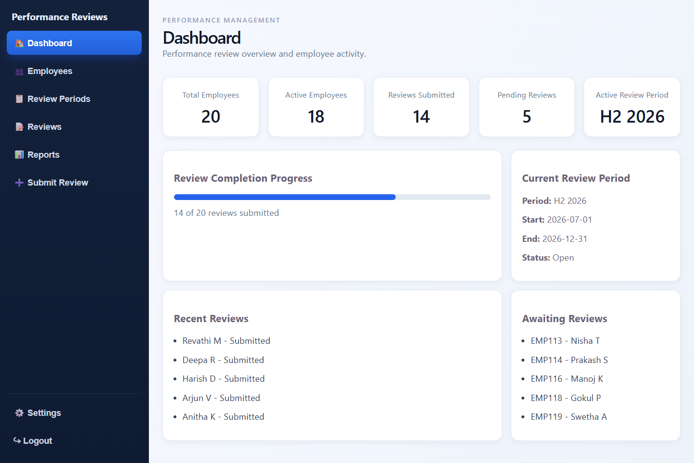
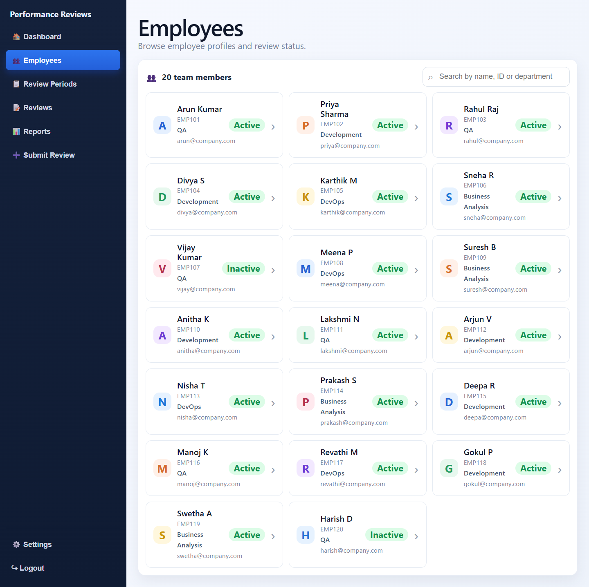
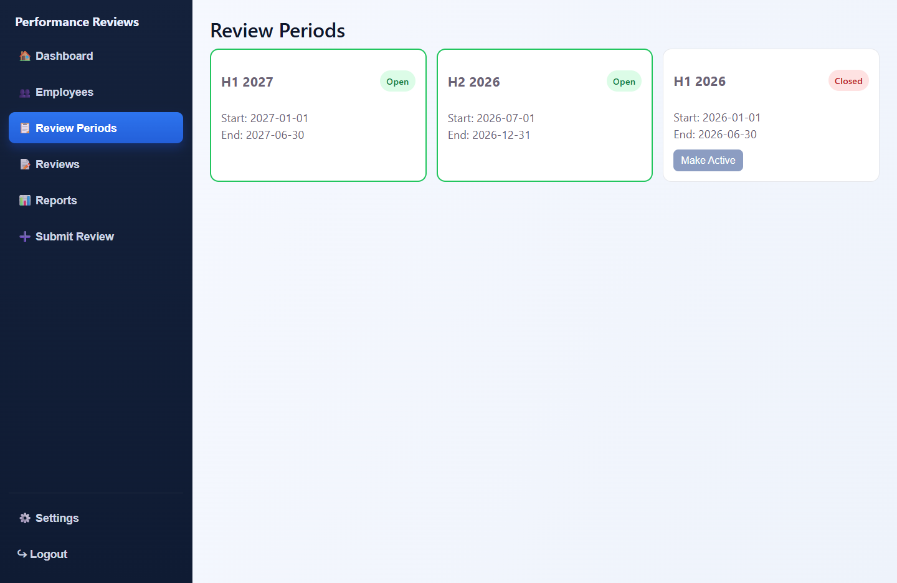
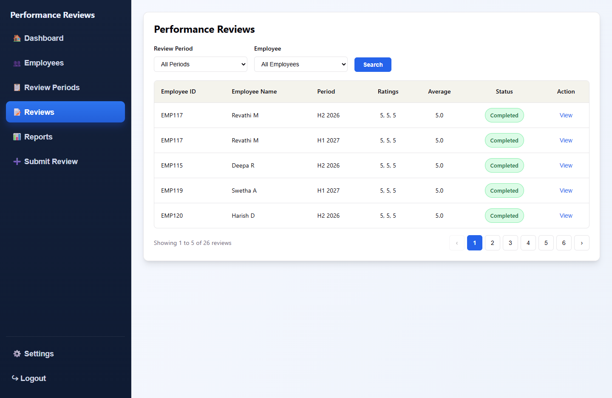
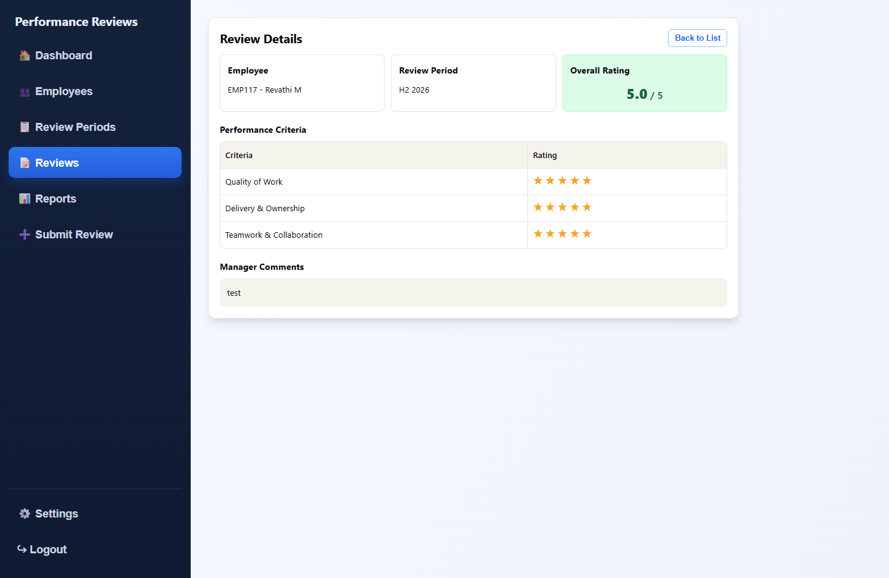
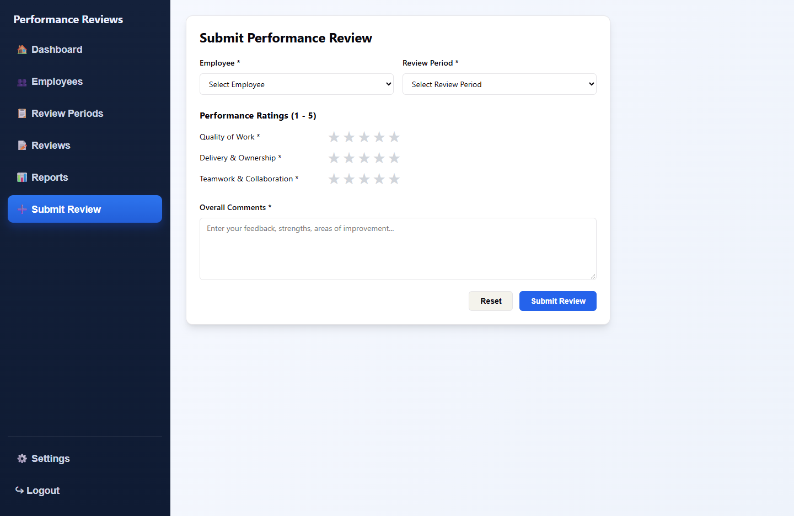
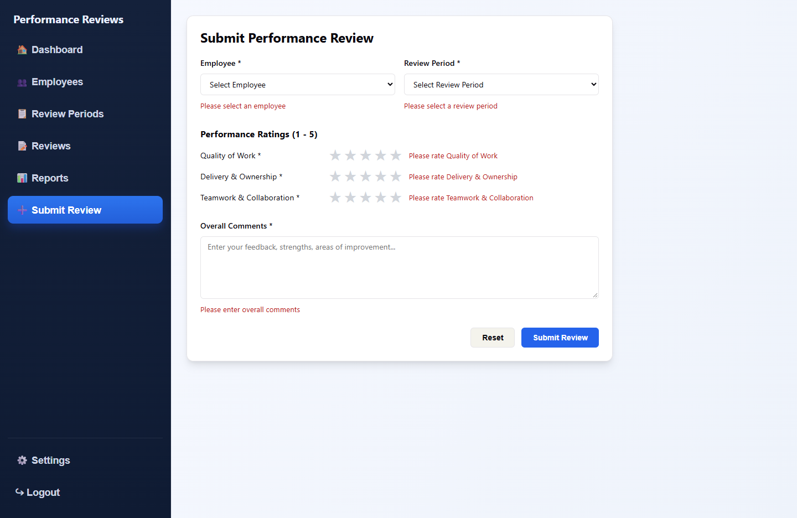

# Employee Performance Review Management System — Frontend

React + TypeScript single-page app for managing employee performance reviews: browse employees, manage review
periods, submit reviews and track completion. It talks to the [FastAPI backend](../performance-review-api/README.md)
at `http://localhost:8000`.

## Tech stack

- React 19 + TypeScript
- Vite (with the React Compiler via Babel)
- Plain CSS, one stylesheet per component
- ESLint

## Screens

### Dashboard

Summary of the current review cycle: employee counts, reviews submitted vs. pending for the open period,
a completion progress bar, the current period's dates, the latest reviews and the employees still waiting for one.



### Employees

Card view of every employee with code, department, email and status. The search box filters by name,
employee ID or department as you type.



### Review Periods

All review periods with their dates and status; open periods are listed first and highlighted.
**Make Active** opens a closed period and closes the one that was open.



### Reviews

Table of submitted reviews with the three ratings, average and status. Filter by review period and/or employee,
then **Search**. Results are paged five at a time; **View** opens the review.



### Review Details

Read-only view of one review: employee, period, overall rating, a star rating per criterion and the manager's
comments. **Back to List** returns to Reviews.



### Submit Review

Form to review an active employee for a review period. All fields are required; ratings are 1–5 stars for
Quality of Work, Delivery & Ownership, and Teamwork & Collaboration. On success the form clears and shows a
confirmation; API errors (for example, a duplicate review) are shown above the buttons.



Submitting with missing fields shows a message next to each one:



> **Reports**, **Settings** and **Logout** are in the side menu but are placeholders for now.

## API calls

| Screen          | Endpoint(s)                                                              |
| --------------- | ------------------------------------------------------------------------ |
| Dashboard       | `GET /api/employees`, `GET /api/review-periods`, `GET /api/reviews?period_id=` |
| Employees       | `GET /api/employees`                                                     |
| Review Periods  | `GET /api/review-periods`, `PUT /api/review-periods/{id}`                |
| Reviews         | `GET /api/reviews?period_id=&employee_id=`                               |
| Review Details  | `GET /api/reviews/{id}`                                                  |
| Submit Review   | `GET /api/employees`, `GET /api/review-periods`, `POST /api/performance-reviews` |

The API base URL (`http://localhost:8000`) is currently written into each component's `fetch` call.

## Getting started

### Prerequisites

- Node.js 20+
- The backend running on `http://localhost:8000` — see the [API README](../performance-review-api/README.md)

### Install and run

From `performance-review-react/`:

```bash
npm install
npm run dev
```

Open http://localhost:5173. The app opens on the Dashboard.

### Scripts

| Command           | What it does                              |
| ----------------- | ----------------------------------------- |
| `npm run dev`     | Start the Vite dev server with hot reload |
| `npm run build`   | Type-check and build to `dist/`           |
| `npm run preview` | Serve the production build locally        |
| `npm run lint`    | Run ESLint                                |

## Project layout

```
src/
  App.tsx                     Page switching (side-nav state) and layout
  components/
    navigation/               SideNav
    dashboard/                Dashboard
    employee/                 EmployeeListPage, EmployeeDropdown
    review_period/            ReviewPeriodPage, ReviewPeriodDropdown
    review_list/              ReviewListPage, ReviewTable, StatusBadge
    review_details/           ReviewDetailsPage
    review_form/              ReviewFormPage (Submit Review)
    star_rating/              StarRating input
    pagination/               Pagination control
  hooks/                      usePaginatedFetch
  interfaces/                 TypeScript types matching the API responses
docs/screenshots/             Screenshots used in this README
```
